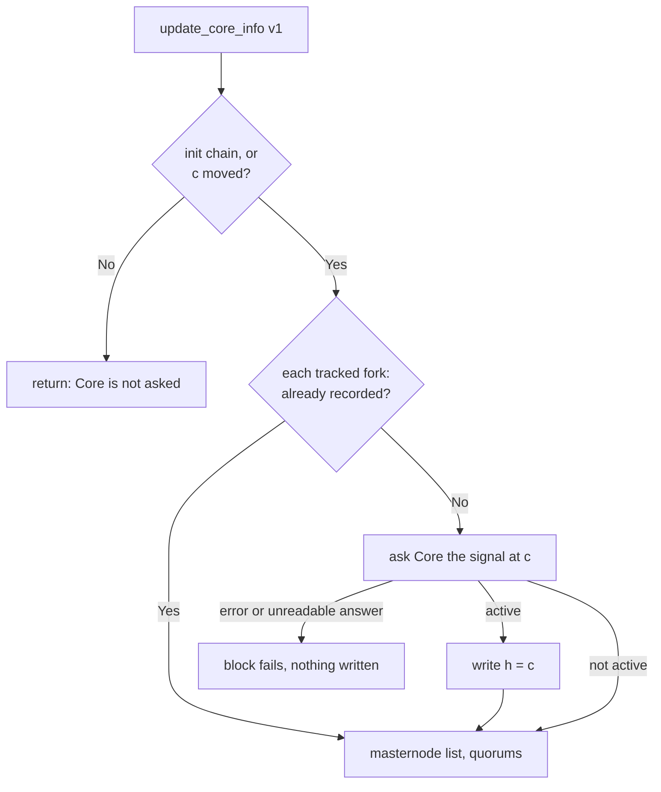

# Core Fork Activations

Some Platform behaviour depends on whether a Dash Core fork is active, for
example a transaction format that Core accepts only once the fork is active.
Core calls its forks deployments. Asking Core every time the answer is needed
would add a Core call, and a way for the block to fail, wherever the answer is
used. Instead Drive keeps a record of the Core forks Platform has seen active.
`update_core_info` fills it in at the block's chain-locked core height `c` (see
[Syncing with Dash Core](component-pipeline.md#syncing-with-dash-core)), and
code that needs to know reads the record. Available from protocol version 15.

## The record

Each tracked fork has at most one item in the `Misc` tree (see
[The GroveDB Structure](../drive/grovedb-structure.md)):

```text
Misc (104) / [b'F', <fork id>] -> chain-locked core height, u32 big endian
```

| Core fork | `CoreFork` | Key | Constant |
|---|---|---|---|
| Dash Core's `DEPLOYMENT_V24` | `CoreFork::V24` | `[b'F', 0]` | `CORE_FORK_V24_ACTIVATION_KEY` |

- The value, `h` below, is the `c` of the first Platform block, or of init chain,
  that checked the fork and found it active. It is not Core's activation height:
  it is at or above it, and above it when `c` jumped past it or when the
  protocol version that tracks the fork came later. Because `h` is the `c` of a
  Platform block, it is the same on every node.
- The item is written once and never changed or deleted. Writing a fork that is
  already recorded is a `CorruptedCodeExecution` error.
- It lives in GroveDB, so the app hash covers it, and clients can prove it with
  `getPathElements`.
- No migration is needed: `Misc` exists on every chain, and a fork never
  recorded reads as absent.

`CoreFork` (`packages/rs-drive/src/drive/system/core_fork_activations/mod.rs`) is
`#[repr(u8)]`. A variant's discriminant is its id in stored keys, so it must
never change; the enum is marked `// @append_only`, which CI enforces (see
[Append-only structures are enforced by CI](../contributing/coding-conventions.md#append-only-structures-are-enforced-by-ci)).
`CoreFork::activation_key` maps each variant to its key.

### Reading it

```rust
// packages/rs-drive/src/drive/system/core_fork_activations/fetch_core_fork_activation_height/mod.rs
pub fn fetch_core_fork_activation_height(
    &self,
    fork: CoreFork,
    transaction: TransactionArg,
    platform_version: &PlatformVersion,
) -> Result<Option<CoreBlockHeight>, Error>
```

Read in a block after `update_core_info`, `Some(h)` means the fork is active at
the block's `c`: `c` never decreases, so `h <= c`, and Core forks never switch
off. `None` means Platform has not seen the fork active. It does not mean the
fork is inactive (see
[The window after a protocol upgrade](#the-window-after-a-protocol-upgrade)).
To ask about another height `x`, compare it with `h`: the fork is known active
at `x` when `x >= h`, and the record says nothing about heights below `h`.

Always pass the block's transaction. A record written in the current block
exists only in that transaction until the block commits.

Nothing caches the record outside GroveDB. A node-local copy would survive a
round that failed and was thrown away, and the next round could then read a
write that never happened. GroveDB is the cache: once a fork is recorded, Core
is never asked about it again.

The read and its writer, `store_core_fork_activation_height`, are
`OptionalFeatureVersion` slots in `drive.methods.platform_system`. Both are
`None` before protocol version 15, where calling them returns
`VersionNotActive`.

## When Platform asks Core

Each tracked fork has a signal: something Core reports that tells whether the
fork is active at a given block (see [V24's signal](#v24s-signal)).
`update_core_info` v1, selected from protocol version 15, starts with
`record_core_fork_activations_v1`, then updates the masternode list and the
quorums as v0 does. For each fork the generation tracks (V24 in v1) that is not
yet recorded, it asks Core the fork's signal at `c`:



So Core is asked about a fork:

- at init chain, at the genesis core height, for a chain born at protocol
  version 15 or later (testnet and mainnet were born at protocol version 1);
- in every block at protocol version 15 or later that moves `c`, until the fork
  is recorded;
- never in a block that keeps `c`, and never again once the fork is recorded.

Each check is one `getblockhash` and one `getspecialtxes`, in a block that is
already calling Core.

### Why every node records the same height

The record after block N depends only on:

- the record after block N - 1;
- block N's protocol version;
- the `c` of blocks N - 1 and N;
- the fork's signal at block N's `c`.

The first three are part of the chain. The signal is read at a chain-locked
height, so every node's Core reports it for the same Core block (see
[Why every node's Core answers about the same block](component-pipeline.md#why-every-nodes-core-answers-about-the-same-block)).
Init chain writes its record before block 1 begins. A round that fails, or that
the network replaces, discards its transaction and the write with it. Nothing
depends on when a node started, whether it restarted, or how fast its Core is.

A node whose Core answers wrongly records a different `h` from everyone else,
and its app hash differs in the very block that records it.

The unit tests at the bottom of
`packages/rs-drive-abci/src/execution/platform_events/core_based_updates/update_core_info/v1/mod.rs`
pin this, including that the record agrees with Core after every block that
moves `c`. The strategy tests in
`packages/rs-drive-abci/tests/strategy_tests/test_cases/core_fork_activation_tests.rs`
cover restarts, the upgrade from protocol version 14 and failed rounds.

## The window after a protocol upgrade

The first block of the protocol version that tracks a fork checks the fork only
if it moves `c`. If it keeps `c`, the fork stays unrecorded until the first
block under that version that does move it. That is usually within one Core
block, about 2.5 minutes, and longer while chain locks stall. During that window
Core may already have the fork active while the record says nothing.

Outside that window the record never lags: every block that moves `c` checks,
and a block that keeps `c` has the same `c`, and so the same answer, as the last
block that checked.

The rule for every consumer of the record: it must be safe while a fork is
active but not yet recorded, or it must run after `update_core_info` in a block
that moves `c`. Code earlier in the block sees the previous block's record. In
particular the protocol upgrade hooks, `upgrade_protocol_version_on_epoch_change`
and `perform_events_on_first_block_of_protocol_change`, run before
`update_core_info`, so they cannot rely on the record for a fork that the same
upgrade starts tracking.

Closing the window would mean asking Core about the fork in the first block of
the new protocol version whatever its `c`. That would put Core on the upgrade
block's critical path: a node whose Core failed could not execute the upgrade
block, and the upgrade would wait for every Core that was down. The upgrade to
protocol version 15 pays that cost once for another reason: it reconciles the
operator payouts Platform holds with Core's full masternode list (see
[Syncing with Dash Core](component-pipeline.md#syncing-with-dash-core)), which
nothing short of that list can do. The fork record does not need it: its window
is short, and every consumer must be safe in it anyway.

## V24's signal

Every Core block's coinbase carries a versioned payload. Dash Core requires
coinbase payload version 4 (`MERKLE_ROOT_ASSETUNLOCKS`) in exactly the blocks
where V24 is active, and refuses it in every other block (`CheckCbTx` in Core's
`src/evo/cbtx.cpp`). Core applies this rule only once V20 is active, as it is on
every chain Platform runs on. So the coinbase of block `c` has payload version 4
or higher if and only if V24 is active at `c`. Core enforces this inside the
block, so every Core that holds block `c` agrees, whatever its own deployment
parameters.

drive-abci reads the signal with `get_coinbase_payload_version(c)`
(`packages/rs-drive-abci/src/rpc/core.rs`, compared with
`V24_COINBASE_PAYLOAD_VERSION`): `getblockhash(c)`, then `getspecialtxes` for
the coinbase alone. A coinbase without a payload is a
`DashCoreBadResponseError`, never "not active". A Core older than v24, whose
coinbase versions stop at 3, treats version 4 as invalid: it stops before the
first V24 block, has no block at `c`, and the read fails rather than answering
"not active".

Core refuses every coinbase version above 4. Reading "4 or higher" as active
assumes that a later Core version which allows a higher one keeps V24's rule.

## Consumers

Code that depends on a Core fork reads the record through
`fetch_core_fork_activation_height`, passing the block's transaction, and
follows the rule in
[The window after a protocol upgrade](#the-window-after-a-protocol-upgrade).

The masternode list update keeps a masternode's operator key when Core
re-encodes it after V24. From protocol version 15, `update_masternode_list` 2
reads V24 from the record. It runs inside `update_core_info` v1, after the
record step at the same `c` and only in blocks that move `c`, so `None` there
means Core reported V24 inactive at this very `c`. `update_masternode_list` 0
and 1, up to protocol version 14, still ask Core directly
(`drop_unchanged_operator_keys`), as the blocks they executed did.

## Adding a fork

A fork is added in three places:

1. A `CoreFork` variant with the next id, its key constant (`[b'F', id]`), its
   `activation_key` arm, and a `StructureNode` for the key in
   `packages/rs-drive/src/drive/system/structure.rs`, with `since` set to the
   protocol version. Regenerate and commit the exported structure file, as
   "Adding GroveDB structure" in the
   [Coding Conventions](../contributing/coding-conventions.md#checklists)
   describes.
2. A new `update_core_info` generation whose recording helper includes the fork
   and its signal, selected by the protocol version that first consumes the
   fork. The list of tracked forks belongs to the generation because each fork
   brings its own signal code. Earlier generations keep their list, so earlier
   protocol versions never ask about the new fork.
3. The consumers, which read `fetch_core_fork_activation_height` and follow the
   rule in
   [The window after a protocol upgrade](#the-window-after-a-protocol-upgrade).
   Code that depends on a fork reads the record; it does not ask Core.

Prefer a signal that Core enforces inside the block, as V24's coinbase version
is.

### Forks without a block-enforced signal

No tracked fork uses such a signal, and drive-abci has no code for one. Some
forks leave no trace in the block: `evo_shares`, for example, is an EHF
deployment (one that masternodes activate through a quorum-signed signal) with
no coinbase signal. The only way to ask Core about such a deployment `D` at `c`
is `getdeploymentinfo` at the block before it:
`getdeploymentinfo(getblockhash(c - 1))` reports `D`'s state for the block after
`c - 1`, which is `c`. `CoreRPCLike` has no call for it: `get_fork_info` reads
deployments at Core's tip, which only init chain may do.

This answer comes from each Core binary's own deployment parameters rather than
from the block, so two Cores running different releases can answer differently
about the same block. Core also leaves out every deployment whose start time is
`NEVER_ACTIVE`. Tracking `D` in a protocol version therefore requires all of
these:

- the minimum Core version dashmate requires must have `D`'s final parameters
  for every network;
- `D` must be scheduled, not `NEVER_ACTIVE`, on every network that runs that
  protocol version. Otherwise every Core leaves `D` out, the missing answer is
  an error, and every block that moves `c` fails;
- drive-abci must check at startup that its Core reports `D`, before the node
  signals support for that protocol version.

## Possible evolution

> **Not implemented.** This describes a possible future shape, not current
> code.

Today each fork's signal is code inside an `update_core_info` generation. Once
a second fork needs tracking, the signals could become data:

```rust
// A sketch, not in the codebase
enum CoreForkSignal {
    /// The coinbase of block `c` has at least this payload version
    CoinbasePayloadVersion(u16),
    /// `getdeploymentinfo` at `getblockhash(c - 1)` reports the deployment active
    Deployment(&'static str),
}
```

The list of tracked forks, each with its signal, would then move into the
version tables, beside `update_core_info`. Tracking a fork whose signal is of a
known kind would become a table entry in the protocol version that first
consumes it, instead of a new generation. With a single fork it is not worth
the indirection.
